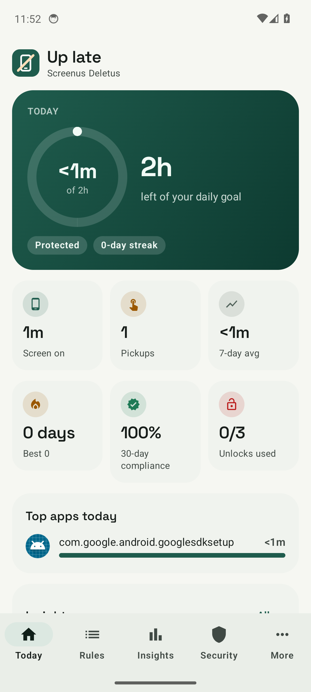
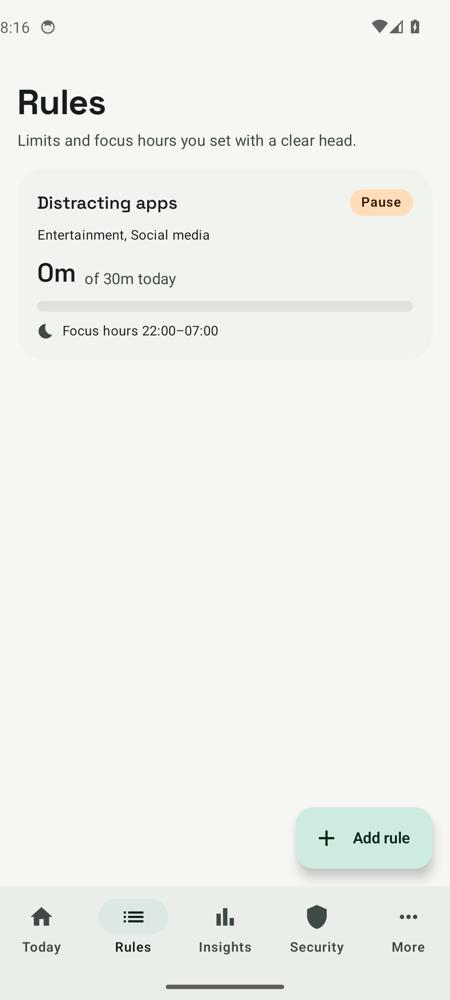
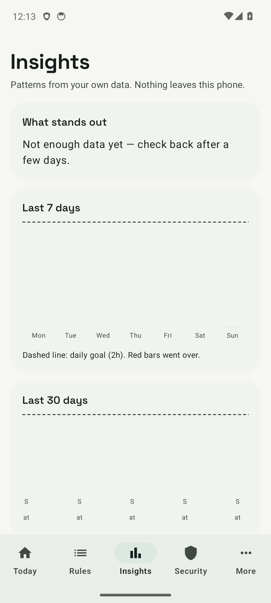
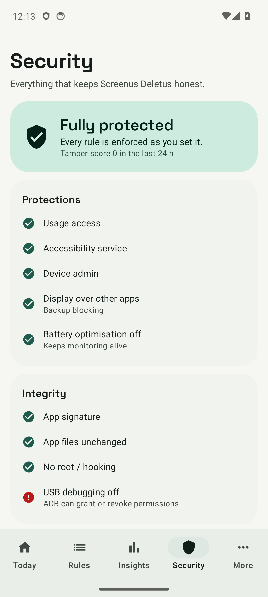
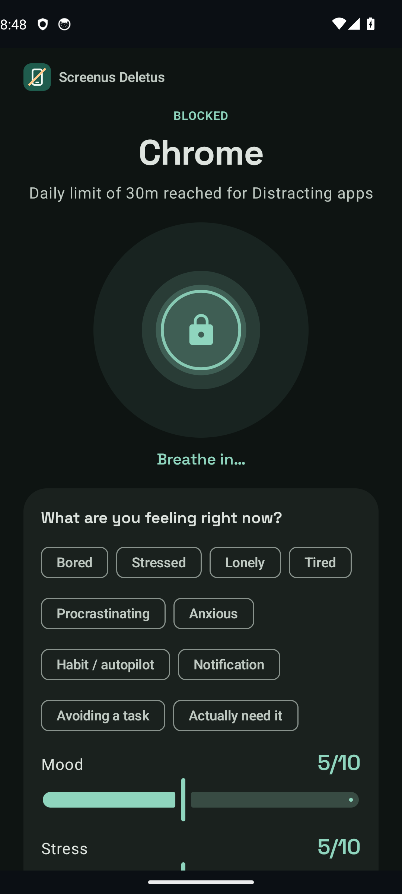
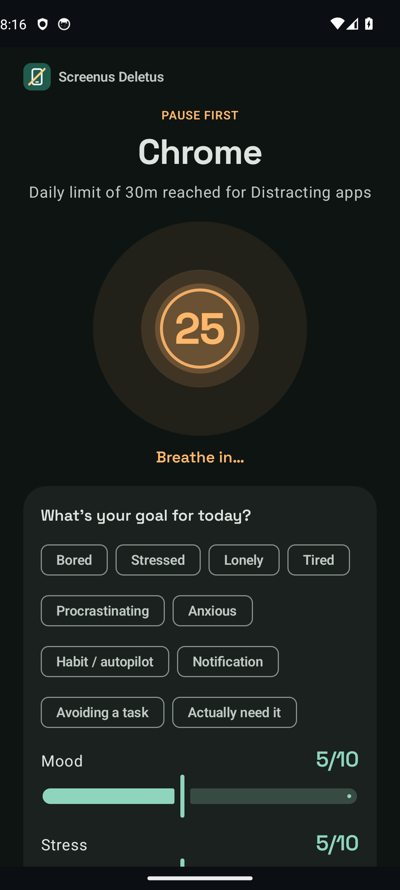
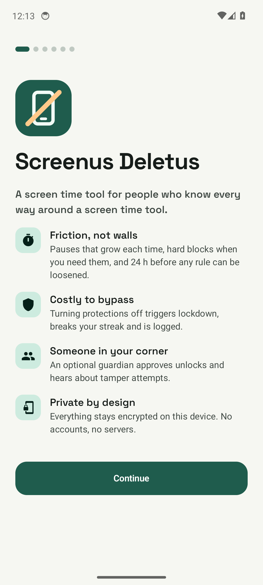
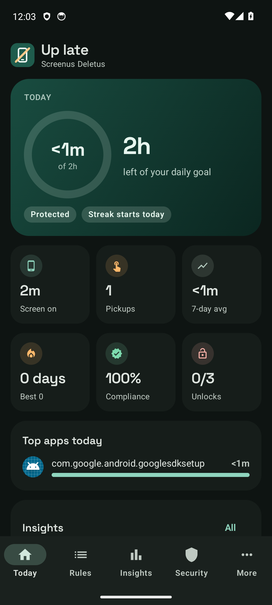

# Screenus Deletus

An Android app for reducing screen time, built for people who know every way around a screen time app. You set limits while you're thinking clearly. Screenus Deletus holds you to them later with friction, accountability and costs, and it makes every way of switching it off slow, logged and visible.

## Screenshots

Captured automatically on an Android 14 emulator by the `UI test (emulator)` workflow (`docs/screenshots/`, light and dark).

| Today | Rules | Insights | Security |
| --- | --- | --- | --- |
|  |  |  |  |

| Block screen | Pause screen | Onboarding | Dark mode |
| --- | --- | --- | --- |
|  |  |  |  |

## What it does

| Area | Features |
| --- | --- |
| **Tracking** | Per-app foreground time, screen-on time and pickups from `UsageStatsManager`; hourly, daily and 30-day history; categories |
| **Rules** | Daily limits and blocked hours per app or category, with three levels: **Warn** (notification), **Pause** (reflection screen with a forced delay that grows each time), **Block** (the app won't open) |
| **Anti-bypass** | Loosening a rule waits out a cooling-off period (24 h by default; it can only be made longer). Tightening applies immediately |
| **Tamper response** | Logs tamper events (device admin or accessibility turned off, usage access revoked, force-stop, clock change, root or hooking framework, USB debugging, re-signed or modified APK, edited rule database). Scores them over 24 h → **Restricted** (every rule one level stricter) → **Lockdown** (every rule is a hard block, for 2–24 h) |
| **Protection pause** | The sanctioned way to turn things off or uninstall: request a pause, wait 30 min (adjustable, can only go up), then you have 15 min in which turning things off doesn't count as tampering. A guardian PIN can start it immediately |
| **Emergency unlock** | Weekly quota, cooldown, a wait that doubles with each unlock (leaving the screen restarts it), a typing challenge, and optionally a guardian PIN. Each unlock counts as a slip and is reported |
| **Psychology** | Reflection prompts and trigger, mood and stress logging on every block; alternative-activity suggestions; streaks; compliance score; insights generated on the device |
| **Guardian** | A trusted person with their own PIN who approves unlocks and early rule changes. Alerts and weekly reports go out by SMS (optional) or wait in an outbox that you're prompted to send by email |
| **Commitment pledge** | Pledge an amount to a charity. Slips add penalties that escalate within the week. It's a ledger only: the app never moves money |
| **Security** | PIN (PBKDF2, 4–12 digits) and biometric lock on the settings area (stats stay viewable without it); EncryptedSharedPreferences; SQLCipher-encrypted Room database; Tink HMAC on every rule; R8 obfuscation |

## Limits

On a phone you own, no app can make itself impossible to remove. Android lets the user turn off device admin, accessibility and usage access at any time, and safe mode, ADB or a factory reset get around any app. Screenus Deletus doesn't try to stop you changing your own settings. It doesn't read or block Settings screens, and the accessibility service only receives the foreground app's package name. Instead, turning a protection off is detected, logged, punished with lockdown and a pledge penalty, and reported to your guardian.

Not included: a backend (so no real-time guardian approval links, peer comparison, cloud AI insights or video confirmation), Play Integrity (it needs a Google Cloud project), and tracking of sections inside apps (e.g. Reels or Shorts).

## Project layout

```
core/   Pure Kotlin, no Android: rule engine, usage aggregation, streaks, unlock and tamper
        policies, commitment ledger, insights. Unit-tested (./gradlew :core:test).
app/    Android app (Jetpack Compose, Material 3, Room + SQLCipher, WorkManager, Tink).
  monitoring/   AccessibilityService (foreground app), foreground service, boot/clock receiver
  enforcement/  EnforcementController, BlockingActivity
  security/     Encrypted prefs, auth, integrity checks, tamper monitor, device admin
  data/         Room database and repositories
  ui/           Screens: onboarding, today, rules, insights, security, guardian, pledge, settings
```

## Building

Requires JDK 17 and the Android SDK (compileSdk 35). minSdk is 29 (Android 10).

```bash
./gradlew :core:test            # logic tests
./gradlew :app:assembleDebug    # app/build/outputs/apk/debug/
./gradlew :app:assembleRelease  # app/build/outputs/apk/release/
```

GitHub Actions (`.github/workflows/build.yml`) runs the tests and uploads both APKs as the `screenus-deletus-apks` artifact on every push. `.github/workflows/ui-test.yml` boots an Android 14 emulator, grants the permissions over adb, runs the `UiTourTest` instrumented test through onboarding and every screen in light and dark mode, reports crashes from logcat, and commits the screenshots to `docs/screenshots/`.

### Release signing

Create a keystore (`keytool -genkeypair -v -keystore release-keystore.jks -keyalg RSA -keysize 4096 -validity 10000 -alias screenus`), then provide the following through `keystore.properties` (git-ignored), environment variables or repository secrets:

| Key | Meaning |
| --- | --- |
| `KEYSTORE_FILE` | Path to the `.jks` (CI: put it base64-encoded in the `KEYSTORE_BASE64` secret) |
| `KEYSTORE_PASSWORD`, `KEY_ALIAS`, `KEY_PASSWORD` | Keystore credentials |
| `SCREENUS_CERT_SHA256` | Optional. SHA-256 of the signing certificate (hex). When it's set, the app treats any other signature as tampering. Without it, the certificate seen on first launch is pinned |

Without a keystore, release builds are signed with the debug key so they still install. Don't distribute those.

## First run

Onboarding asks about your habits, sets a PIN, and walks you through granting **usage access** and the **accessibility service** (both required), plus **device admin**, notifications, display over other apps and ignoring battery optimisation (all recommended). It then creates a first rule for the categories you picked.

To uninstall later: Security → **Pause protection** → wait → deactivate device admin under Settings → Security → Device admin apps → uninstall.
